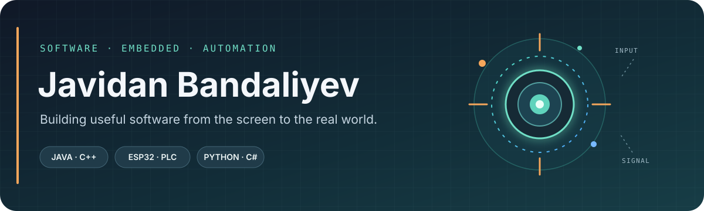
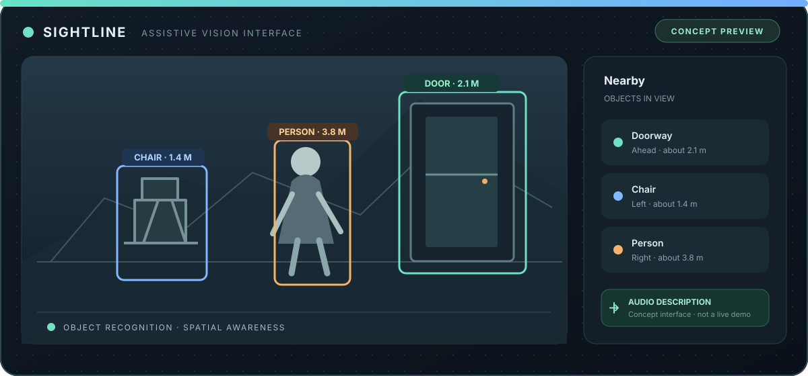

  

  
  

I build things where **software meets the physical world**. I enjoy turning a messy problem into a working prototype, then improving it through debugging and testing. My strongest ground is **object-oriented programming**, **problem solving**, and **hands-on development** across software, embedded systems, and automation.

---

## 01 / Toolbox

<strong>LANGUAGES</strong>

<strong>DEVELOPMENT & TOOLS</strong>

<strong>HARDWARE & AUTOMATION</strong>

<code>ESP32</code> &nbsp; <code>Embedded C/C++</code> &nbsp; <code>PLC</code> &nbsp; <code>Siemens TIA Portal</code>

---

## 02 / Selected work

<table>
  <tr><td></td></tr>
  <tr><td>
    <h3>Assistive Vision Glasses</h3>
    
Smart-glasses software that connects an ESP32 camera to a Python backend. Local YOLO object detection and navigation logic process the scene and prepare spoken guidance.

    
<code>Python</code> <code>FastAPI</code> <code>YOLO</code> <code>ESP32</code> <code>Text to speech</code>

    

  </td></tr>
</table>

More projects will be added here as I build them.

---

## 03 / Experience

**PLC Development Intern** · Holcim Azerbaijan  
May 2024 – October 2024

---

## 04 / Certificates & awards

<strong>International STEM Olympiad · 2025</strong>

  
  

  
  

